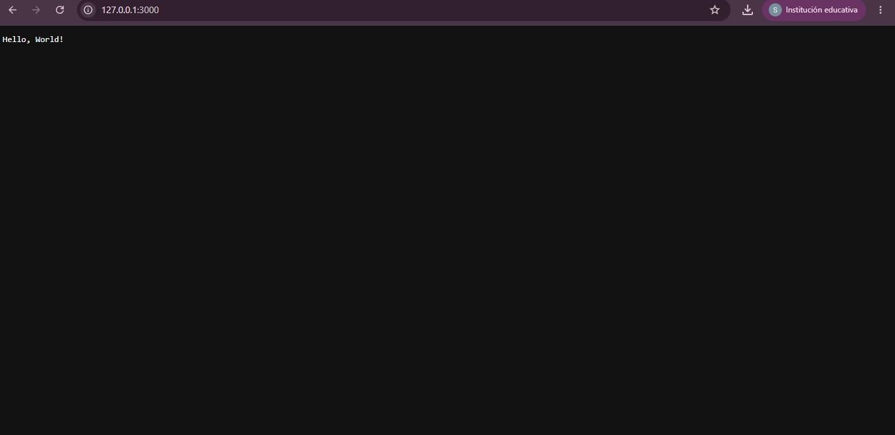

# js_avanzado

## EJEMPLO
En el ejemplo práctico se puede ver el funcionamiento de Node.js porque demuestra cómo el **motor V8** ejecuta JavaScript directamente sobre el sistema operativo fuera del navegador web, mientras que su método `server.listen()` activa un **proceso monohilo (** **single-thread** **)** que no se detiene ni bloquea la terminal, sino que se mantiene a la espera gracias al **bucle de eventos (** **Event Loop** **)**, de modo que cada vez que ingresas a la dirección en el navegador se genera un **evento de solicitud** que dispara de inmediato la función *callback* `(req, res)` para responder y cerrar la conexión de forma **asíncrona y no bloqueante** utilizando únicamente los módulos nativos de red de su biblioteca estándar.